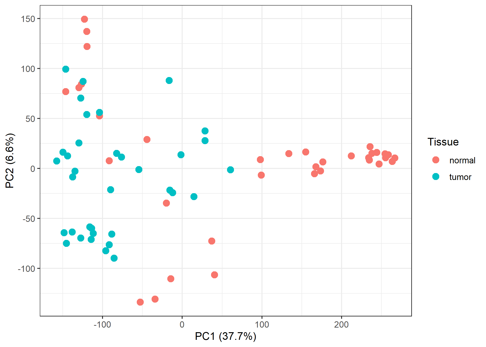
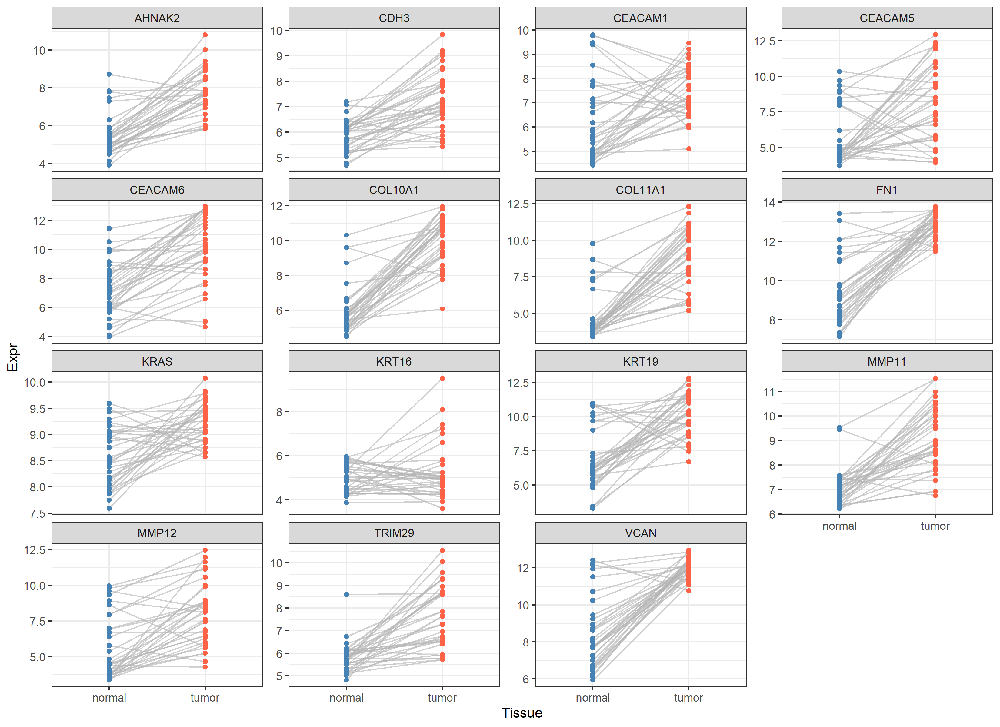
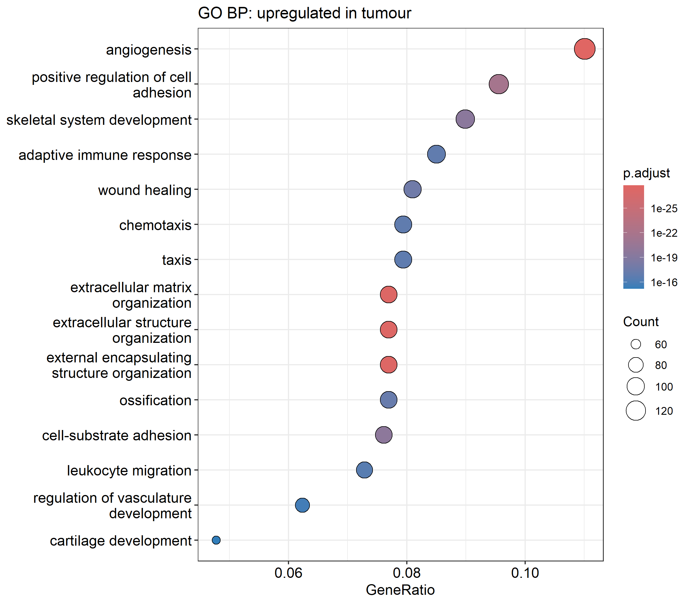
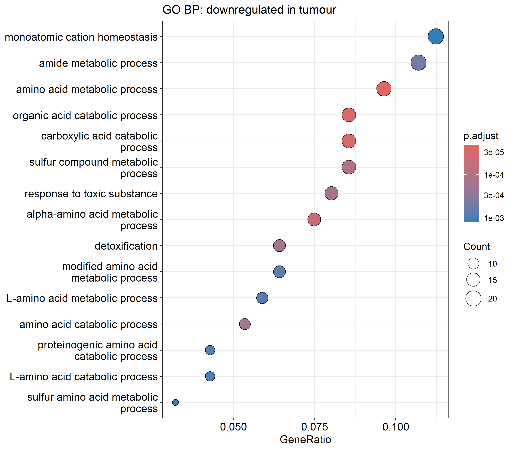
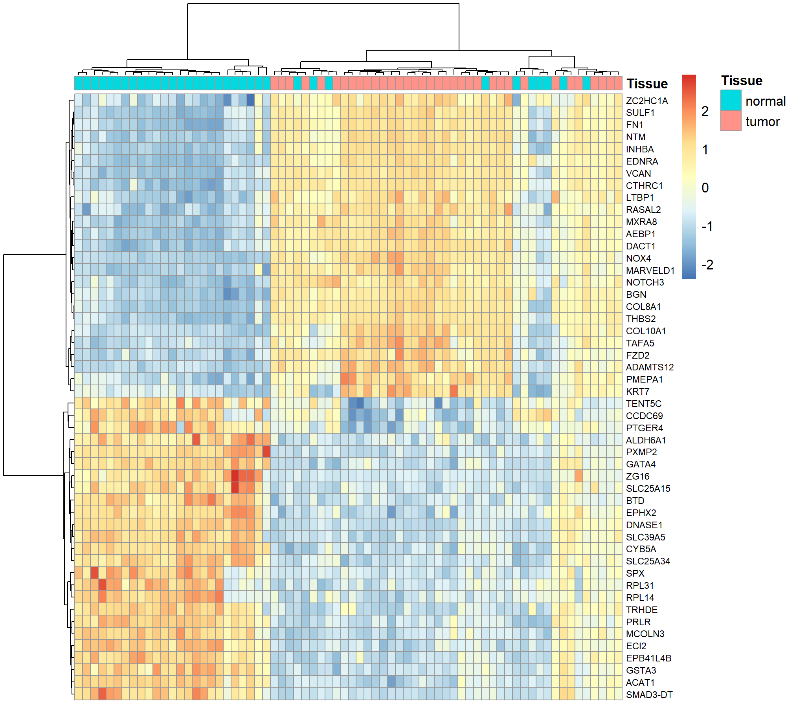

# Pancreatic Cancer Transcriptomics: GSE15471

Differential expression and functional enrichment analysis of paired pancreatic tumour and matched normal tissue from the public microarray dataset GSE15471.

## Aim

Identify genes and biological processes that differ between pancreatic tumour and matched normal tissue, and examine 15 candidate genes of interest.

## Dataset

| | |
| --- | --- |
| Source | NCBI GEO, [GSE15471](https://www.ncbi.nlm.nih.gov/geo/query/acc.cgi?acc=GSE15471) |
| Platform | Affymetrix Human Genome U133 Plus 2.0 (GPL570), 54,675 probes |
| Samples | 78 hybridizations from 36 patients (tumour and matched normal) |
| Data scale | log2, RMA-normalized (range 2.1 to 14.8) |
| Software | R 4.5.2, limma, clusterProfiler, ggplot2, pheatmap |

## Methods

1. **Sample organization.** Replicate hybridizations were checked by Pearson correlation (0.987 to 0.994) and averaged within patient and tissue, giving 72 patient-level profiles.
2. **Quality control.** PCA and inter-sample correlation identified one technical outlier (51681_normal, mean correlation 0.71 versus at least 0.90 for all other samples). The whole patient was removed to keep the paired design, leaving **35 pairs (70 samples)**.
3. **Filtering.** Probes were kept if expressed above the global median in at least 18 of 70 samples (30,529 of 54,675 probes).
4. **Differential expression.** limma with a paired design (`~ Patient + Tissue`) and Benjamini-Hochberg correction. Strongly differentially expressed probes: adj.P < 0.05 and |logFC| >= 1.
5. **Annotation.** Probe IDs mapped to gene symbols with `hgu133plus2.db`.
6. **Enrichment.** GO Biological Process and KEGG over-representation (up and down separately, background = genes tested), plus GSEA on the full ranking by moderated t-statistic (one probe per gene).
7. **Sensitivity analysis.** The model was refitted with an acinar-content score (mean of scaled CPA1, PRSS1, CELA3A, PNLIP and CTRB1 expression) as a covariate.

## Key results

| Step | Result |
| --- | --- |
| Original analysis (36 pairs, unfiltered) | 39,690 probes with adj.P < 0.05 |
| After outlier removal (35 pairs, unfiltered) | 39,510 probes |
| After filtering (30,529 probes tested) | 22,311 probes with adj.P < 0.05 |
| **Strong changes (adj.P < 0.05, \|logFC\| >= 1)** | **2,253 probes: 1,942 up, 311 down** |
| Unique genes | 1,315 up, 205 down (background 15,035 genes) |
| GSEA (GO BP) | 1,305 terms enriched in tumour, 80 in normal |
| Acinar-adjusted model | 1,859 strong probes, 1,841 shared with the main model (82% of 2,253) |

The large number of significant probes at adj.P < 0.05 reflects a strong global difference in tissue composition between tumour and normal bulk tissue (see PCA), so the |logFC| >= 1 set is used for interpretation.

### Biological findings

- **Upregulated in tumour:** extracellular matrix organization, cell adhesion, angiogenesis, wound healing, integrin signaling and immune-related processes. Top genes include INHBA, POSTN, COL10A1, COL8A1, COL11A1, SULF1, CTHRC1, COL1A1/2, VCAN and THBS2. This is consistent with the desmoplastic stroma typical of pancreatic cancer.
- **Downregulated in tumour:** amino acid metabolism, organic acid catabolism, detoxification and drug metabolism (for example GNMT).
- **Candidate genes:** COL10A1, COL11A1, FN1, VCAN, KRT19, CDH3, AHNAK2, MMP11, MMP12, TRIM29 and CEACAM6 were clearly upregulated. CEACAM1 and CEACAM5 were variable between patients. KRAS showed a small increase (about 0.7 logFC) below the cutoff. KRT16 showed no change. The probe plotted for each gene is listed in `results/candidate_probe_used.csv`.
- **Acinar genes:** CPA1, PRSS1, CELA3A, PNLIP and CTRB1 were lower on average but not significant (adj.P 0.14 to 0.37). Expression was bimodal in both normal and tumour samples, consistent with variable acinar content in bulk tissue.
- **Robustness:** after adjusting for acinar content, 83% of strongly upregulated probes (1,616 of 1,942) and 72% of strongly downregulated probes (225 of 311) remained. The stromal and extracellular matrix program is therefore robust to acinar content, while the downregulated list is somewhat more sensitive to tissue composition.

## Figures

| | |
| --- | --- |
| PCA (35 pairs) | `figures/QC_PCA_no_outlier.png` |
| Volcano plot | `figures/volcano_35pairs.png` |
| Heatmap, top 50 genes by t-statistic | `figures/heatmap_top50.png` |
| GO dot plots | `figures/GO_dotplot_up.png`, `figures/GO_dotplot_down.png` |
| GSEA dot plot | `figures/GSEA_GO_dotplot.png` |
| Candidate genes (paired) | `figures/candidate_genes_paired.png` |
| Acinar genes (paired) | `figures/acinar_genes_paired.png` |
| PCA coloured by acinar score | `figures/PCA_acinar_score.png` |

## Repository structure

```
scripts/    numbered R scripts (run in order 01 to 06)
data/       intermediate R objects (.rds)
results/    CSV tables and sessionInfo.txt
figures/    all plots
```

Superseded outputs from the first analysis (36 pairs, with the outlier) are in `old_36pairs/` subfolders and are kept for reference only.

## How to run

1. Open R in the project folder.
2. Run the scripts in `scripts/` in order, 01 to 06, for example `source("scripts/02_QC_outlier_filtering.R")`.

Notes:
- The `data/` folder is not included in this repository. Script 01 expects the replicate-averaged expression matrix (`data/pancreatic_expression_averaged.rds`). It can be regenerated from GEO by downloading GSE15471 with `GEOquery` and averaging replicate hybridizations within patient and tissue, as described in the comments of script 01.
- Script 04 needs an internet connection for KEGG.
- Package versions are recorded in `results/sessionInfo.txt`.

## Limitations

- **Bulk tissue.** Expression differences mix tumour-cell, stromal and immune signals. Enriched terms are described as associated with tumour tissue, not as drivers of cancer.
- **Normal samples are matched non-tumour tissue from cancer patients,** not healthy pancreas. Some cluster with tumours on the PCA and heatmap, and acinar genes were highly variable.
- **Probe-level ambiguity.** Several genes have probes that disagree (for example CEACAM1, CEACAM5, MMP11, TRIM29, KRAS). Results for these genes depend on the probe chosen.
- **Annotation artifacts.** Terms such as ossification, skeletal system development and infection-related KEGG pathways arise from shared matrix, complement and immune genes, not from those processes.
- **Expression, not mutation.** KRAS activity in pancreatic cancer is mainly mutational and is not measured here.
- **No independent validation.** Results come from a single dataset. Validation in another cohort (for example another GEO pancreatic dataset or TCGA-PAAD) would strengthen them.

## Data source
	
Badea L, Herlea V, Dima SO, Dumitrascu T et al. Combined gene expression analysis of whole-tissue and microdissected pancreatic ductal adenocarcinoma identifies genes specifically overexpressed in tumor epithelia. Hepatogastroenterology 2008 Nov-Dec;55(88):2016-27. PMID: 19260470
Idichi T, Seki N, Kurahara H, Yonemori K et al. Regulation of actin-binding protein ANLN by antitumor miR-217 inhibits cancer cell aggressiveness in pancreatic ductal adenocarcinoma. Oncotarget 2017 Aug 8;8(32):53180-53193. PMID: 28881803

## Visualizations

### Quality Control


### Candidate Gene Analysis


### GO Enrichment




### Gene Expression Heatmap


## Project Workflow

[View the complete analysis workflow](docs/workflow.md)

## Key Findings

- Identified differentially expressed genes between pancreatic tumour and normal tissue samples.
- Observed changes in genes associated with extracellular matrix organization, cell adhesion, and wound healing.
- Investigated candidate genes including COL10A1, FN1, VCAN, COL11A1, AHNAK2, CDH3, and CEACAM6.
- Performed Gene Ontology enrichment analysis to explore biological processes associated with the differentially expressed genes.
- Generated PCA plots, volcano plots, heatmaps, and enrichment visualizations.

## Tools and Technologies

- R and RStudio
- Bioconductor
- GEOquery
- limma
- clusterProfiler
- ggplot2
- AnnotationDbi
- GitHub
